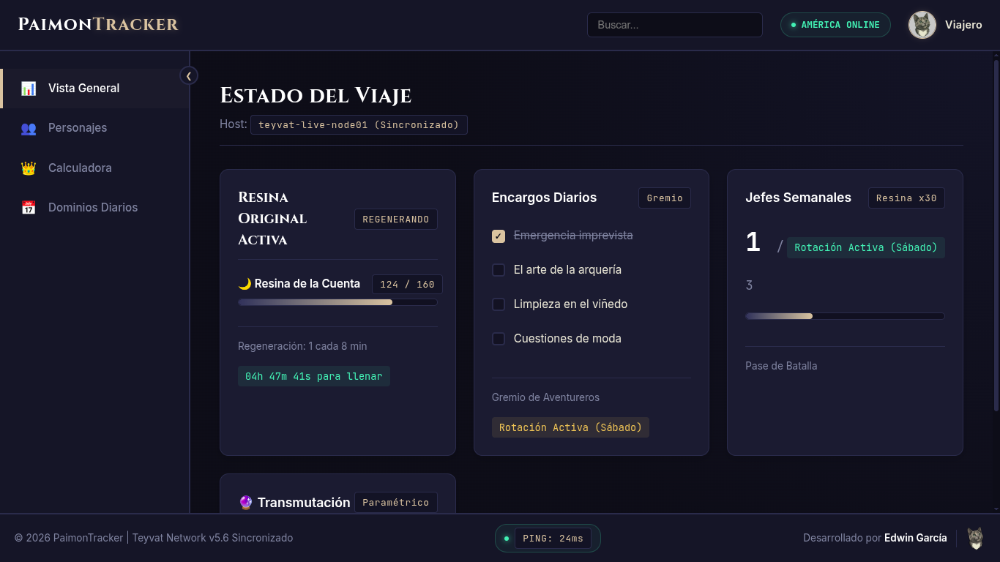

# 🔮 PaimonTracker | Centro de Comando de Teyvat

**PaimonTracker** es un panel de control avanzado (Dashboard) e interactivo enfocado en el monitoreo de recursos analíticos, gestión de resina activa, control de encargos diarios, cálculo de Valor Crítico (CV) de artefactos y planificación de dominios de optimización para Genshin Impact. Este sistema web simula de forma dinámica las variables en tiempo real del servidor mediante una arquitectura modular moderna, ofreciendo una experiencia visual fluida, responsiva y de grado profesional.

## 🖼️ Vista Previa del Sitio

<p align="center">
  
</p>

## 🛠️ Tecnologías Utilizadas

Este proyecto ha sido desarrollado bajo los estándares más estrictos del desarrollo frontend nativo, priorizando la pureza del código y rechazando por completo el uso de librerías sobrecargadas o frameworks innecesarios:

* **HTML5 Semántico Estricto:** Arquitectura limpia con exclusión total de etiquetas contenedoras genéricas (`<div>`). En su lugar, se implementaron componentes nativos de alta accesibilidad (`<header>`, `<main>`, `<aside>`, `<section>`, `<article>`, `<fieldset>`) y elementos de medición como `<progress>`.
* **CSS3 Moderno Avanzado:** Estructuración robusta mediante variables globales (`:root`), distribución de tarjetas optimizada con CSS Grid y Flexbox para la correcta alineación y prevención de desbordamientos visuales.
* **JavaScript Moderno Modular (ES6+):** Lógica interactiva nativa dividida en módulos limpios (`import` / `export`), temporizadores asíncronos en tiempo real, persistencia de datos local (`localStorage`) y cálculo analítico de estadísticas.

## ✨ Características Principales

* **Motor de Resina en Tiempo Real:** Simulación asíncrona exacta de la regeneración de la Resina Original (1 unidad cada 8 minutos) con persistencia temporal incluso al cerrar el navegador.
* **Calculadora de Artefactos Funcional:** Ingresa tu Probabilidad y Daño Crítico para obtener al instante el Valor Crítico (CV), clasificación por Tier (Dios, Excelente, Útil, Descarte) y porcentaje de eficiencia.
* **Encargos Diarios Interactivos:** Marcado de misiones con actualización automática del progreso del Gremio de Aventureros y estado de Katheryne ("Pendiente" vs "¡Reclamado!").
* **Rotación de Dominios Dinámica:** Detección automática del día de la semana del sistema para mostrar los materiales de talento y armas activos en la rotación actual.
* **Barra Lateral con Persistencia:** Menú de navegación colapsable cuyas preferencias de visualización se memorizan mediante `localStorage`.

## 📂 Estructura del Proyecto

```text
paimon-tracker/
├── assets/                # Iconos de estado, favicon y recursos gráficos del ecosistema
├── css/             
│   └── style.css          # Estilos globales, variables de diseño oscuro y consultas de medios
├── js/              
│   ├── main.js            # Orquestador principal modular
│   └── modules/           # Módulos lógicos independientes
│       ├── sidebar.js     # Control de la barra lateral colapsable
│       ├── resin.js       # Motor de tiempo real y regeneración de resina
│       ├── commissions.js # Gestión de encargos y estado de Katheryne
│       ├── artifacts.js   # Calculadora analítica de Valor Crítico (CV)
│       └── domains.js     # Rotación inteligente de dominios por día
├── index.html             # Vista General (Métricas de resina y bitácora de encargos)
├── personajes.html        # Módulo de visualización, nivel y armas de los viajeros
├── artefactos.html        # Calculadora analítica del Valor Crítico (CV)
├── dominios.html          # Calendario y rotación de materiales activos del día
├── LICENSE                # Licencia del proyecto (MIT)
└── README.md              # Documentación técnica del repositorio
```

## 💡 Cómo Ejecutarlo

* **Paso 1:** Clona este repositorio en tu estación de trabajo local.
* **Paso 2:** Abre el archivo `index.html` utilizando cualquier navegador web moderno (se recomienda la extensión *Live Server* en entornos de desarrollo para apreciar el renderizado preciso de rutas relativas y caché).

¡Listo! El proyecto es una aplicación frontend estática pura, eliminando dependencias de Node.js, configuraciones de empaquetadores o instalaciones de *npm*.

## 📝 Licencia

Este proyecto está bajo la Licencia MIT. Consulta el archivo [LICENSE](LICENSE) para más detalles.

---
<p align="center">
  
  <br />
  <sub><b>Desarrollado por Edwin García</b> | 2026</sub>
</p>
